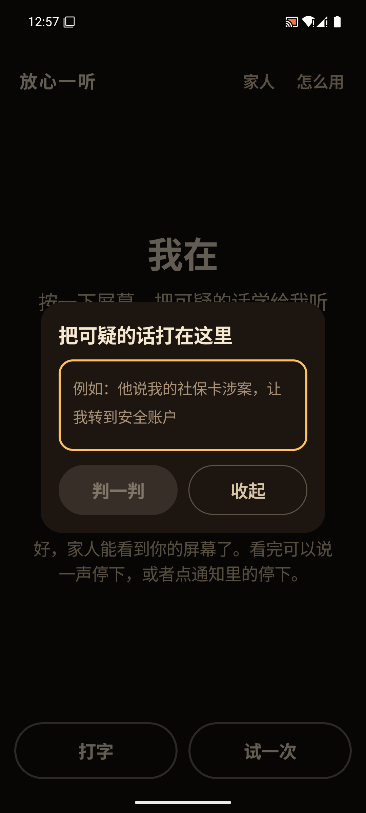

# 放心一听（Android）

给看不见、看不清的长辈用的语音防诈助手。不用找按钮、不用读小字：按住屏幕，把可疑的话学一遍，它用声音告诉您这是不是骗子、为什么、接下来怎么做。

  

## 界面

| 语音判断 | 小望 |
| --- | --- |
|  |  |

截图来自 Android 15 模拟器；语音识别和朗读使用手机系统服务。

## 核心体验

1. 打开 App，按住屏幕中间，把骗子刚才说的话学一遍。
2. 松手后，本机把语音转成文字，规则层与语义特征层一起判断风险。
3. 用声音和红 / 黄 / 绿结论告诉您结果，并给出三条动作：先挂断、别转账、打 96110。
4. 想再听就说“再说一遍”；想报警就说“打 96110”；想结束就说“停”。

## 功能

- 完全语音优先：按钮、状态、结论和动作都能朗读，适配读屏和低视力用户。
- 自动朗读可设：右上角「帮助 + 设置」，设置页两个开关默认都开——「换个页面，念给我听」管切屏要点，「结论和回答，念给我听」管判定结论、云端回话与家人端提醒；系统读屏（TalkBack）开着时界面朗读自动让位，显式操作（再说一遍、打 96110、念配对码）一定出声。
- 不依赖阅读：结果用短句和三条动作表达，避免长段文字和专业术语。
- 打字兜底：不方便说话时，可直接输入可疑话术，同样能得到判断。
- 语音指令：支持“再说一遍”“打 96110”“停”等短指令。
- 家人配对：老人端生成 9 位配对码（兼容旧版 6 位），家人输入后即可接收风险警报。
- 远程协助：家人每次查看屏幕都需要老人单独同意，最多 5 分钟、每秒 1 帧、480 像素宽，停止即删除。
- 隐私保护：不注册、不登录；App 不保存录音；只把系统语音识别出的文字交给云端判断；卡号、身份证号、手机号只展示后四位。

## 适用场景

- 接到自称社保、银行、公安、客服的电话，越听越不对劲，但不知道该怎么判断。
- 对方要求转账、报验证码、下载陌生 App，老人不方便阅读长文，也不确定下一步做什么。
- 已经和对方聊了一半，想先停下来，让家人或 96110 帮忙确认。

## 产品边界

- 判断结果只作辅助，不替代公安、银行、社保等官方渠道。
- 产品只说“很可能是骗子”“先别急着办”，不对事件做法律定性。
- 看不清、听不准、信息不足时给黄色或“没听准”兜底，绝不把可疑内容说成“安全”。

## 下载与构建

- 安装包：[放心一听 1.0.4 APK](release/放心一听.apk)（`./gradlew packageDeliveryApk` 产出，固定这个名字）
- 包名：com.fangxin.yiting
- 最低系统：Android 8.0（API 26）
- 构建：JDK 17、Android SDK 35，执行：

      ./gradlew :app:assembleDebug

Windows 使用 gradlew.bat。

## 代码结构

    app/src/main/java/com/fangxin/yiting/
    ├── MainActivity.kt          # 入口与页面切换
    ├── VoiceMachine.kt          # 语音状态机：听、判断、播报、指令
    ├── domain/                  # 风险规则、判定、风险等级与家人模型
    ├── data/LinkStore.kt        # 本机配对码与家人警报
    ├── data/SettingsStore.kt    # 朗读开关（默认开，只存本机）
    ├── link/LinkClient.kt       # 与「放心一眼」同源中转的配对连接
    ├── service/                 # 家人常驻连接、屏幕共享前台服务
    ├── speech/                  # 系统语音识别与朗读
    ├── net/AskClient.kt         # 云端判断接口
    ├── audio/Cues.kt            # 提示音与等待反馈
    └── ui/                      # 大字界面、家人页面、设置页、主题

## 验证与限制

- 已在 Android 15 模拟器走查语音判断、朗读、家人配对和屏幕共享流程。
- v1.0.3 在 Android 15 模拟器（Google TTS 中文语音）实测朗读门控：两个开关全开时切屏与结论都出声、全关时零次合成、force-stop 重启后开关状态保持、开 TalkBack 后界面朗读自动让位；真机听感与各厂商离线语音包差异仍未验证。
- 2026-11-20 图标更换与 1.0.4 发布：桌面图标换成软 3D 猫头鹰（奶油+金丝头戴耳机、胸前红灯笼），背景与「放心一眼」新图标同款（奶油底 + 金环），源图 `vibe_images/yiting-launcher-matched_1795159279037_a41a8a98.png`。自适应图标由 `@color/icon_bg` + `@drawable/idle` 两层改为单层——`mipmap-anydpi-v26/ic_launcher.xml` 的 background 指向 `drawable-nodpi/ic_launcher_full.png`（1024×1024，915,830 字节），foreground 透明；`idle.webp` 仍被界面使用，未删除。按 66dp 安全区（108dp 层中心 61%）合成预览：耳机、脸、灯笼完整，仅脚底被圆角削掉一点；主体占比与一眼图标对齐（高 58.3% vs 57.8%，宽 43.3% vs 44.1%）。
- 1.0.4 出包与线上核对：`packageDeliveryApk` 构建成功，`release/放心一听.apk` 为 versionCode 5 / versionName 1.0.4、2,533,193 字节；`apksigner verify` 通过，证书 `CN=Fangxin Yiyan`（SHA-256 以 `3a62ee0b` 开头，与一眼同一把密钥，覆盖安装依赖签名一致）；`aapt2 dump badging` 确认包名 `com.fangxin.yiting`、桌面名「放心一听」；包内 `res/fE.png` 与工程图标 md5 一致，确认新图标确实进了包。站点在 QoderCN 重新发布（actionId `b58fa4ce-7ec3-4b9a-8aea-349d72dde2ce`，`published=true`）：首页 200 且引用新产物 `index-DJ3a9itS.js`，`https://fangxin-yiting-oqspdkiq3lk.qoder.zone/放心一听.apk` 返回 200、Content-Length 2,533,193、整包 md5 与本地一致；`/functions/v1/app/ask` 带 Origin 头 POST 返回红色判定模板（不带 Origin 会被网关 403 `sites_gateway_origin_forbidden`，属平台来源校验，不是故障）。
- 未验证：新图标在真机桌面与不同启动器遮罩下的实际显示效果只做了合成预览；1.0.3 → 1.0.4 覆盖安装未实测。
- 语音识别与朗读依赖手机系统服务；不同厂商的离线语音包和音色可能不同。
- 真实老人、真实来电和双机跨设备并发仍需在更多机型上验证。
- 本仓库只包含 Android 原生实现，不包含网页版源码。
